<div align="center">

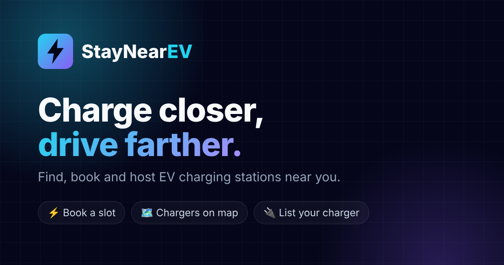

# ⚡ StayNearEV – Frontend

**Find, book and host EV charging stations.**
React app with a 3D hero, live map, public EV chargers, Google sign-in and slot booking.

[🌐 Live app](https://staynearevfrontend.onrender.com) ·
[🔌 Backend repo](https://github.com/Luckyverma04/StayNearEv) ·
[📘 API docs](https://github.com/Luckyverma04/StayNearEv#-api-reference)


</div>

---

## 📸 Screenshots

> Screenshots use demo data.

| Home with 3D charger | Stations near you |
|---|---|
| 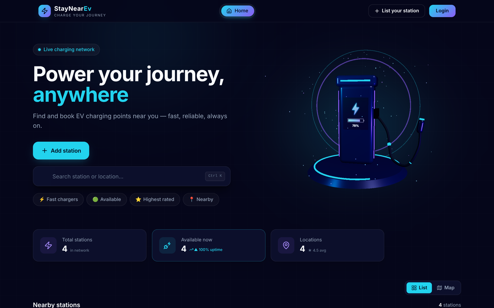 | 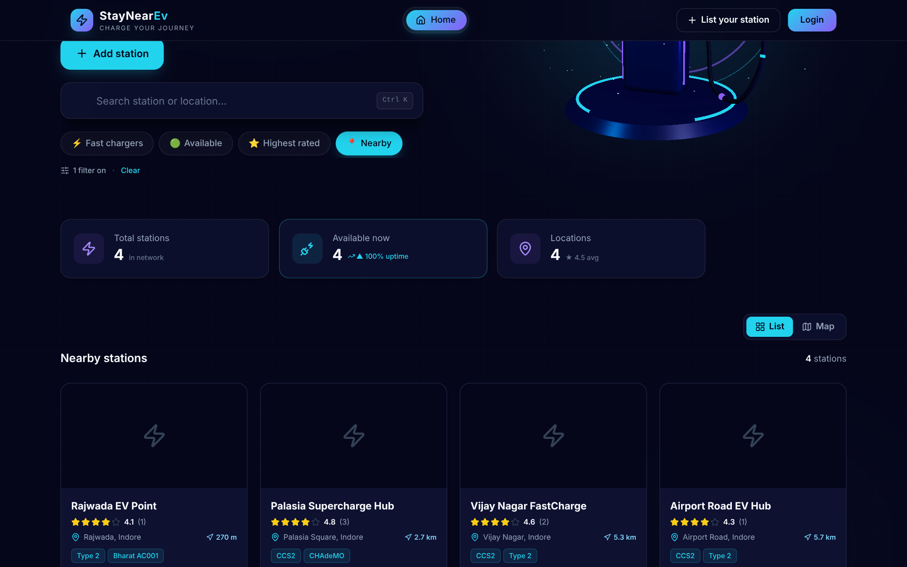 |

| Map view | Public charging points |
|---|---|
| 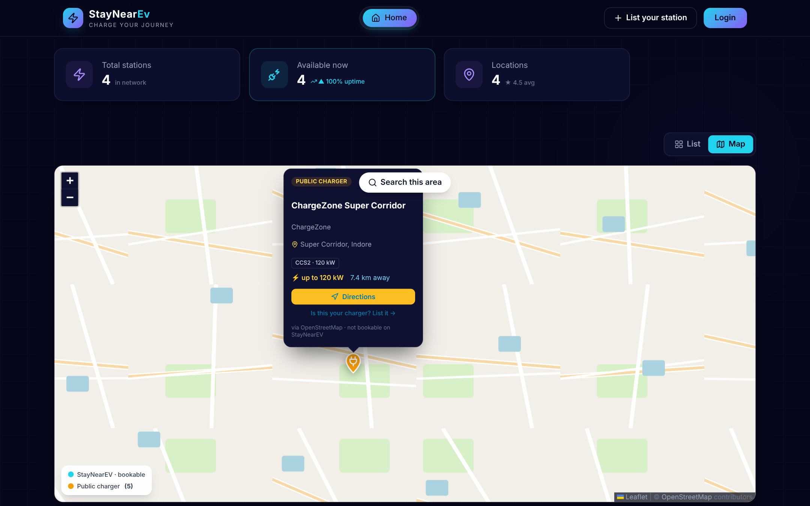 | 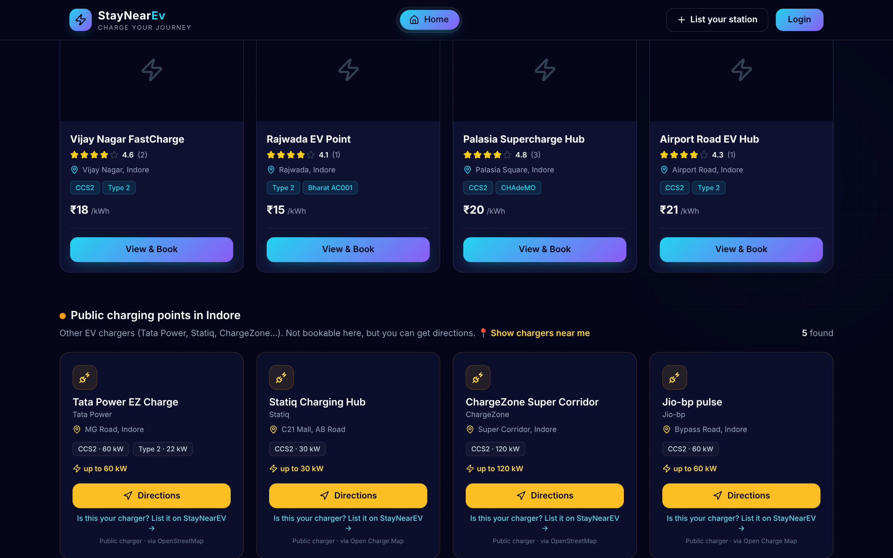 |

| Login / Signup with Google | Booking confirmed |
|---|---|
| 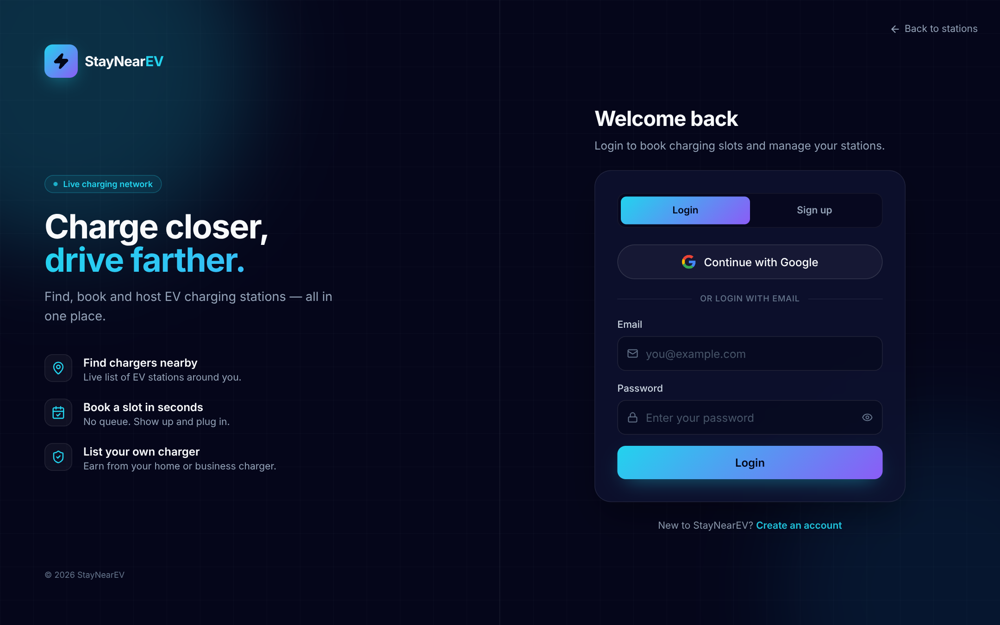 | 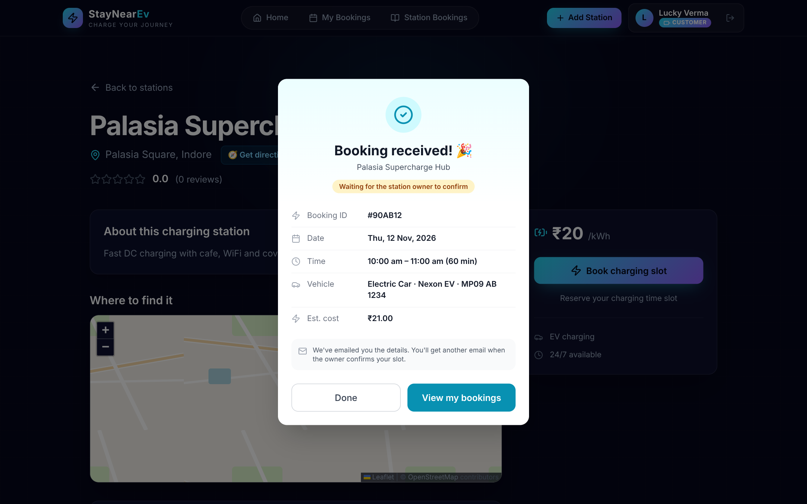 |

| My bookings | Station owner dashboard |
|---|---|
| 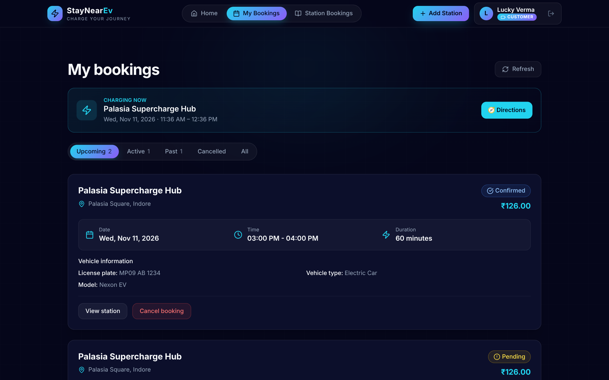 | 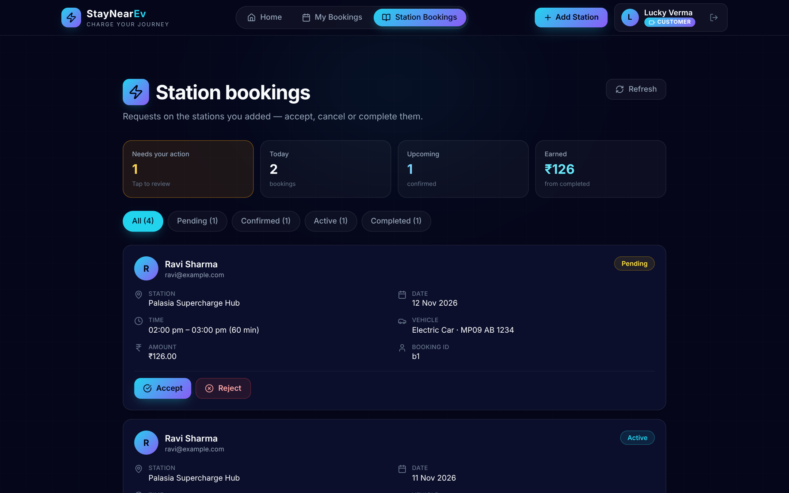 |

| Profile | Mobile |
|---|---|
| 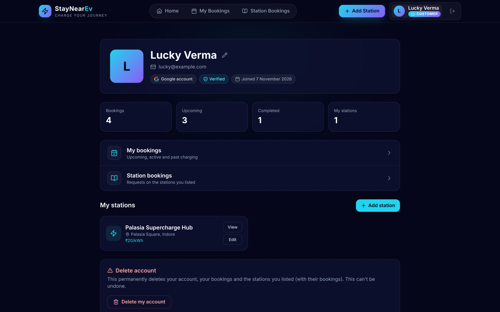 | 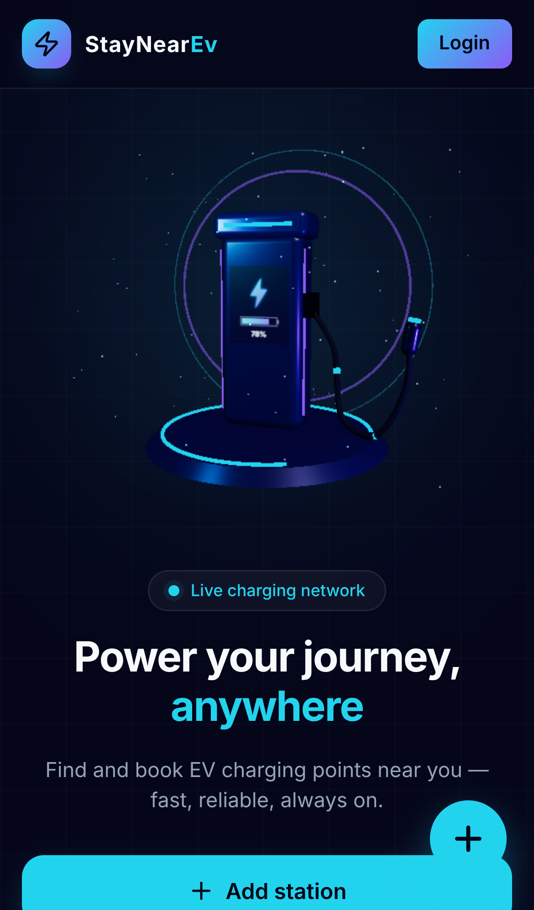 |

---

## ✨ Features

- **3D hero:** interactive EV charger built with three.js (glowing screen, energy pulses, particles), follows the mouse; lazy-loaded, pauses off-screen, flat image fallback on old devices or reduced motion
- **Browse without login:** home and station pages are public; login is asked only to book or list a station, then you return to the same page
- **Map + Nearby:** list / map toggle, real distance ("2.3 km") from your location, directions in Google Maps
- **Public chargers:** Tata Power, Statiq, ChargeZone… from OpenStreetMap + Open Charge Map in amber; default city Indore
- **"Is this your charger? List it":** opens Add Station prefilled with name, address, map pin and charger types
- **Booking flow:** slot picker → "Booking received" screen → Upcoming / Active / Past tabs with a "Your next charge" card
- **Station owners:** dashboard with "needs your action", today's bookings, upcoming and earnings; confirm / cancel in one click
- **Auth:** email + password with OTP, **Continue with Google**
- **Profile:** photo, edit name, my stations, delete account
- **Polish:** cyan + violet theme, 3D tilt cards, share preview image, favicon, mobile friendly

## 🛠️ Tech stack

| Part | Tech |
|---|---|
| UI | React 19, React Router 7, Tailwind CSS, lucide-react |
| Build | Vite |
| 3D | three.js, @react-three/fiber |
| Maps | Leaflet, react-leaflet, OpenStreetMap tiles |
| Auth | JWT (from backend), Google Identity Services |
| API | Axios → [StayNearEV backend](https://github.com/Luckyverma04/StayNearEv) |
| Hosting | Render (static site) |

## 🗺️ Pages

| Route | Page | Login |
|---|---|---|
| `/` | Home: 3D hero, search, filters, list / map, public chargers | – |
| `/stations/:id` | Station details, map, reviews, booking | – |
| `/login` | Login / Signup / Google | – |
| `/verify-otp` | Email OTP | – |
| `/stations/create` | Add a station (map pin picker) | ✅ |
| `/stations/edit/:id` | Edit a station | ✅ |
| `/my-bookings` | My bookings | ✅ |
| `/my-station-bookings` | Bookings on my stations | ✅ |
| `/profile` | Profile | ✅ |
| `/admin/dashboard`, `/admin/bookings` | Admin | 👑 |

---

## 🚀 Run locally

```bash
git clone https://github.com/Luckyverma04/StayNearEvFrontend.git
cd StayNearEvFrontend
npm install
cp .env.example .env   # then fill in the values
npm run dev            # http://localhost:5173
```

Run the [backend](https://github.com/Luckyverma04/StayNearEv) on port 3002, or point `VITE_API_URL` to the live API.

### Environment variables

| Key | Description |
|---|---|
| `VITE_API_URL` | Backend URL, e.g. `http://localhost:3002/api` or `https://staynearevbackend.onrender.com/api` |
| `VITE_GOOGLE_CLIENT_ID` | Google OAuth Client ID (same as backend `GOOGLE_CLIENT_ID`) |
| `VITE_SHOW_DEMO` | `true` shows demo stations (local testing only) |

### Scripts

| Command | What it does |
|---|---|
| `npm run dev` | Start the dev server |
| `npm run build` | Production build into `dist/` |
| `npm run preview` | Preview the production build |
| `npm run lint` | ESLint |

### Deploy (Render static site)

- Build command: `npm install && npm run build`
- Publish directory: `dist`
- Add the environment variables above
- `public/_redirects` sends every route to `index.html` so page refresh works

## 📁 Project structure

```
src/
├── App.jsx                # routes + login guard
├── pages/                 # Home, Station, Login, Bookings, Profile, Admin…
├── components/
│   ├── auth/              # login/signup forms, Google button, auth layout
│   ├── map/               # stations map, map pin picker, icons
│   ├── station/           # station + public charger cards
│   ├── three/             # 3D charger scene
│   ├── layout/            # navbar
│   └── common/            # booking modal, reviews…
├── context/AuthContext.jsx
├── hooks/                 # useTilt, useRedirectTarget
├── services/              # API calls (axios)
└── utils/geo.js           # distance, directions, default city
docs/                      # banner + screenshots
```

---

## 🖼️ Image links

Direct links to every image (use them in LinkedIn, resume, portfolio):

| Image | Link |
|---|---|
| Banner | https://raw.githubusercontent.com/Luckyverma04/StayNearEvFrontend/main/docs/banner.png |
| Home (3D) | https://raw.githubusercontent.com/Luckyverma04/StayNearEvFrontend/main/docs/screenshots/home.png |
| Stations list | https://raw.githubusercontent.com/Luckyverma04/StayNearEvFrontend/main/docs/screenshots/stations-list.png |
| Map view | https://raw.githubusercontent.com/Luckyverma04/StayNearEvFrontend/main/docs/screenshots/map.png |
| Public chargers | https://raw.githubusercontent.com/Luckyverma04/StayNearEvFrontend/main/docs/screenshots/public-chargers.png |
| Login | https://raw.githubusercontent.com/Luckyverma04/StayNearEvFrontend/main/docs/screenshots/login.png |
| Booking confirmed | https://raw.githubusercontent.com/Luckyverma04/StayNearEvFrontend/main/docs/screenshots/booking-confirmed.png |
| My bookings | https://raw.githubusercontent.com/Luckyverma04/StayNearEvFrontend/main/docs/screenshots/my-bookings.png |
| Station owner dashboard | https://raw.githubusercontent.com/Luckyverma04/StayNearEvFrontend/main/docs/screenshots/station-bookings.png |
| Profile | https://raw.githubusercontent.com/Luckyverma04/StayNearEvFrontend/main/docs/screenshots/profile.png |
| Mobile | https://raw.githubusercontent.com/Luckyverma04/StayNearEvFrontend/main/docs/screenshots/mobile-home.png |
| Share preview | https://raw.githubusercontent.com/Luckyverma04/StayNearEvFrontend/main/public/og-image.png |

---

<div align="center">

Made with ⚡ by **[Lucky Verma](https://github.com/Luckyverma04)**

</div>
